<div align="center">


<br><br>

&nbsp;<a href="#"></a>&nbsp;<a href="#"></a>&nbsp;<a href="#"></a>

**Transforming E-Commerce. Visualize apparel instantly. Seamlessly styled.** <br>
<sub>*A modern, high-performance virtual try-on and style recommendation platform.*</sub>

</div>

<div align="center">
<a href="#architecture_flow"></a>
</div>

## Quick Start — Local Environment Setup

*Virtual Try-On Studio requires specific Node.js and environment configurations to run the frontend and backend services smoothly.*

**Requirements**: Node.js (v18+ recommended), npm.

### 1. OS-Specific Prerequisites

<details>
<summary><b>Windows Setup</b> (Click to expand)</summary>

Ensure Node.js and npm are installed and added to your System Environment Variables (PATH). 
*(Note: If PowerShell script execution fails, run PowerShell as Administrator: `Set-ExecutionPolicy Unrestricted -Force`)*.
</details>

<details>
<summary><b>Linux (Debian/Ubuntu) Setup</b> (Click to expand)</summary>

```bash
sudo apt update
sudo apt install nodejs npm build-essential
```

</details>

<details>
<summary><b>macOS Setup</b> (Click to expand)</summary>

```bash
brew install node
```

</details>

### 2. Configure Infrastructure

Create a `.env` file in the root directory of the project:

```dotenv
VITE_SUPABASE_URL=your_supabase_url
VITE_SUPABASE_PUBLISHABLE_KEY=your_supabase_publishable_key
VITE_SUPABASE_PROJECT_ID=your_supabase_project_id
```

### 3. Launch the Application

```bash
git clone https://github.com/FatimaBilal110/Virtual-tryon-Studio.git
cd Virtual-tryon-Studio
npm install
npm run dev 
```

## Under the Hood

### 1. Modern Frontend Architecture
The application features a fully redesigned, responsive user interface built using React, TypeScript, and Tailwind CSS. It includes intuitive image dropzones, camera capture components, and sleek navigation layouts to ensure a smooth user experience across devices.

### 2. Serverless Backend Engine
Powered by Supabase Edge Functions, the platform handles core image processing and AI workloads efficiently behind the scenes—including the try-on engine, style recommendations, and ghost mannequin processing.

### 3. Folder Map

```text
├── src/                  # Frontend application source
│   ├── components/       # Reusable UI components & modals
│   ├── pages/            # Application views (Index, Style, Ghost, etc.)
│   ├── integrations/     # Supabase client and types
│   └── lib/              # Site utilities and configurations
├── supabase/             # Supabase Edge Functions (tryon, style-recommend, ghost-mannequin)
└── public/               # Static assets & brand media 
```